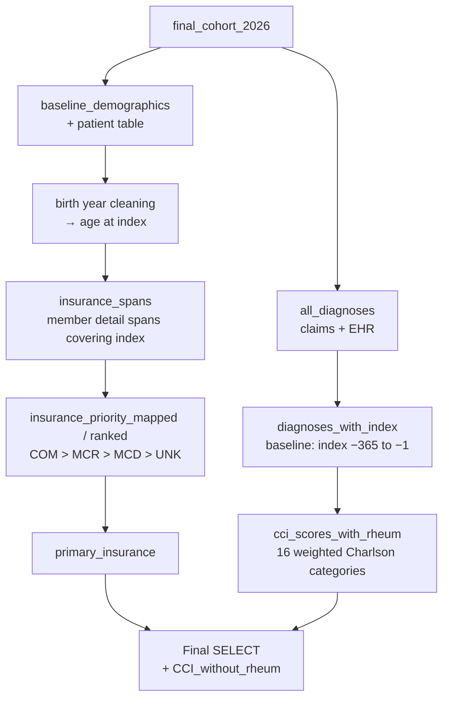

# Baseline Characteristics & Charlson Comorbidity Index (CCI)
 
**Data source:** Optum Market Clarity — Sjögren's / Graves' Disease Cohort
**Schema:** `market_clarity_graves_disease_202605_v1_20260622_prod`
**SQL dialect:** Trino / Presto (e.g., AWS Athena)
**Population:** Final SjD cohort, `final_cohort_2026` (130,284 patients; see `README_Patient_Funnel.md`)
**Output grain:** One row per patient (`ptid`)
 
---
 
## 1. Purpose
 
This query builds the **baseline characteristics table** for the SjD study cohort. For each patient it gives:
 
- **Demographics:** age at index, gender, race, ethnicity, and geographic region.
- **Insurance:** the primary payer type at the index date, chosen by a priority rule.
- **Comorbidity burden:** a **Charlson Comorbidity Index (CCI)** score for the 365 days before index. The **rheumatologic disease** component is left out, because SjD is itself a rheumatic disease and would otherwise add to every patient's score.
These fields populate the baseline characteristics table (Table 1) of the study report.
 
---
 
## 2. Data Sources
 
### 2.1 Source tables (Optum Market Clarity)
 
| Table | Data type | Fields used |
|---|---|---|
| `argenx_graves_202605_pt` | Patient demographics | `ptid`, `birth_yr`, `gender`, `race`, `ethnicity`, `region` |
| `argenx_graves_202605_clm_med_diag` | Medical claim diagnoses | `ptid`, `diag`, `fst_dt` |
| `argenx_graves_202605_diag` | EHR diagnoses | `ptid`, `diagnosis_cd`, `diag_date` |
| `argenx_graves_202605_clm_mbr_dtl` | Member enrollment detail, including line of business | `ptid`, `eligeff`, `eligend`, `bus` |
 
The schema name indicates a **May 2026 data cut (`202605`), version 1, built 22 June 2026**. *(Inferred from the naming convention — confirm with the data engineering team.)*
 
### 2.2 Upstream dependency
 
| Object | Role | Required columns |
|---|---|---|
| `final_cohort_2026` | Final SjD cohort from the patient funnel | `ptid`, `date_of_first_diagnosis` (index date) |
 
---
 
## 3. Processing Logic
 

 
| CTE | What it does |
|---|---|
| `baseline_demographics` | Adds birth year, gender, race, ethnicity, and region to each cohort patient. |
| `birth_year_normalized` | Cleans the birth year (`'1937 and Earlier'` → 1937, `'Unknown'` → null). |
| `birth_date_corrected` | Converts the birth year to a date, using 1 January of that year. |
| `baseline_with_age` | Calculates age at the index date in whole years. |
| `all_diagnoses`, `diagnoses_with_index` | Gather all claims and EHR diagnoses for cohort patients and attach each patient's index date. |
| `cci_scores_with_rheum` | Scores each Charlson category from baseline diagnoses and adds them up to the CCI (rheumatologic disease is excluded from the total). |
| `insurance_spans` | Finds member enrollment spans that contain the index date. |
| `insurance_priority_mapped`, `insurance_ranked`, `primary_insurance` | Keep one payer per patient, using a fixed priority order. |
| Final `SELECT` | Combines demographics, insurance, and CCI. Patients with no qualifying diagnoses get a CCI of 0. |
 
---
 
## 4. Business Rules
 
### 4.1 Demographics
 
**BR-01 — Source.** Gender, race, ethnicity, and region are taken as recorded in the Optum patient table, without recoding.
 
**BR-02 — Birth year.** `'1937 and Earlier'` becomes 1937. `'Unknown'` becomes null.
 
**BR-03 — Age at index.** Every patient is assumed to be born on 1 January of their birth year. Age is then the number of whole years from that date to the index date, which works out to the index year minus the birth year. Patients with an unknown birth year have no age.
 
### 4.2 Insurance
 
**BR-04 — Spans considered.** Only member-detail spans that contain the index date are used. A missing `eligend` is treated as open-ended.
 
**BR-05 — Primary payer.** When more than one span covers the index date, one payer is chosen in this order:
 
| Line of business (`bus`) | Meaning | Priority |
|---|---|---|
| `COM` | Commercial | 1 |
| `MCR` | Medicare (Advantage) | 2 |
| `MCD` | Medicaid (managed) | 3 |
| `UNK` | Unknown | 4 |
| Any other value, or no span | — | **0 (ranked first — see Section 7, item 2)** |
 
### 4.3 Charlson Comorbidity Index
 
**BR-06 — Baseline window.** Diagnoses are counted from **index − 365 days to index − 1 day**. The index date itself is excluded.
 
**BR-07 — Sources.** Medical claim and EHR diagnoses both count. Codes are upper-cased, trimmed, and stripped of dots. A single occurrence of a code is enough.
 
**BR-08 — Scoring.** Each category scores its weight once if the patient has any of its codes in the window. The CCI is the sum of the 16 category scores in Section 5. Patients with no qualifying diagnoses score 0.
 
**BR-09 — Rheumatologic disease excluded.** A rheumatologic disease score (`RheumD_score`) is calculated, but it is **not** added to the total. Its codes cover rheumatoid arthritis, SLE, systemic sclerosis, myositis, overlap syndromes, polymyalgia rheumatica, and giant cell arteritis. The output column is therefore named `CCI_without_rheum`. The CTE is named `cci_scores_with_rheum` even though the total leaves rheumatologic disease out.
 
---
 
## 5. CCI Categories and Weights
 
The code lists combine **ICD-10-CM** and **ICD-9-CM** codes, following the Quan/Deyo-style Charlson code mappings. Only the ICD-10 codes matter for this study, because the baseline windows start in 2020 or later.
 
| Category | Score column | Weight in script | Standard Charlson weight |
|---|---|---|---|
| Myocardial infarction | `MI_score` | 1 | 1 |
| Congestive heart failure | `chf_score` | 1 | 1 |
| Peripheral vascular disease | `PVD_score` | 1 | 1 |
| Cerebrovascular disease | `cvd_score` | 1 | 1 |
| Dementia | `dementia_score` | 1 | 1 |
| Chronic pulmonary disease | `cpd_score` | 1 | 1 |
| Peptic ulcer disease | `PUD_score` | 1 | 1 |
| Mild liver disease | `MLD_score` | 1 | 1 |
| Diabetes without chronic complications | `DwoCC_score` | 1 | 1 |
| **Diabetes with chronic complications** | `DwCC_score` | **1** | **2** |
| **Hemiplegia or paraplegia** | `Hemi_Para_score` | **1** | **2** |
| Renal disease | `RenalD_score` | 2 | 2 |
| Any malignancy, including lymphoma and leukemia | `AnyM_score` | 2 | 2 |
| Moderate or severe liver disease | `MSLiverD_score` | 3 | 3 |
| Metastatic solid tumor | `MetaST_score` | 6 | 6 |
| HIV/AIDS | `hiv_score` | 6 | 6 |
| *Rheumatologic disease* | `RheumD_score` | *1 (excluded from total)* | *1* |
 
The highest possible score as coded is 30.
 
---
 
## 6. Output Specification
 
| Column | Description |
|---|---|
| `ptid` | Optum de-identified patient ID |
| `date_of_first_diagnosis` | Index date |
| `gender`, `race`, `ethnicity`, `region` | Demographics as recorded |
| `age_index` | Age at index in years |
| `eligeff`, `eligend` | The member-detail span selected as primary at index |
| `bus` | Line of business of the primary span |
| `mapped` | Priority value of `bus` (Section 4.2) |
| `priority_order` | Always 1 (the row kept for the patient) |
| `CCI_without_rheum` | Charlson score without the rheumatologic disease component (0 if no qualifying diagnoses) |
 
---
 
## 7. Assumptions, Limitations, and Points for Review
 
Items marked **Action** should be resolved before results are shared.
 
**1. Two CCI weights are lower than the standard Charlson weights — high priority.** Diabetes with chronic complications and hemiplegia/paraplegia score 1 here, but standard Charlson scores them 2. Mean CCI is understated for patients with these conditions. **Action:** change both weights to 2, or document why they differ.
 
**2. Unexpected payer values are ranked ahead of Commercial — high priority.** Any `bus` value other than COM/MCR/MCD/UNK gets priority 0, which sorts **ahead of** Commercial. So a patient with a Commercial span and a span with an unexpected or null value is reported as the unexpected value. Patients with no span covering the index date also get priority 0, with a null `bus`. **Action:** give "other" values priority 5, label "no coverage found" separately, and check the distinct `bus` values in the data.
 
**3. No Charlson hierarchy is applied.** Standard Charlson counts only the more severe condition in each related pair. This script counts both, so a patient can score both conditions in a pair:
- diabetes without and with complications;
- mild and moderate/severe liver disease;
- any malignancy and metastatic solid tumor.
**Action:** apply the hierarchy, e.g., set `DwoCC_score` to 0 when `DwCC_score > 0`.
 
**4. Code typo in the malignancy list.** `'946'` appears in the "any malignancy" list, between the C94.x codes. It looks like a typo for `C946` (myelodysplastic disease, not classified elsewhere). As written it matches nothing in the ICD-10 era, so C94.6 is not counted. **Action:** correct it to `C946`.
 
**5. Birth-year values do not match the funnel.** This script maps only `'1937 and Earlier'`. The patient funnel also maps `'1936 and Earlier'`. Any other top-coded text value fails to parse, so the patient gets a null age instead of being placed in the oldest age group. **Action:** use the same mapping as the funnel, and check the distinct `birth_yr` values.
 
**6. Age may be overstated by up to one year.** Assuming a 1 January birthday means age at index can be overstated by up to one year. This is the same approach as the funnel's adult check, but should be noted if age is reported as a continuous variable.
 
**7. Ties in the payer choice are arbitrary.** If two spans have the same priority, `row_number()` keeps one at random. The reported `eligeff`/`eligend` may then differ between runs. **Action:** add a tie-breaker (e.g., latest `eligeff`).
 
**8. Two different enrollment tables.** Payer type comes from `clm_mbr_dtl`, while the funnel's continuous-enrollment check uses `clm_con_enrl`. Spans can differ between the two. **Action:** confirm that every cohort patient has a `clm_mbr_dtl` span covering the index date.
 
**9. All EHR diagnosis statuses count.** "History of" or "possible" diagnoses in the EHR count toward CCI categories, which may overstate comorbidity compared with a claims-only CCI.
 
**10. HIV/AIDS coverage is narrow.** Only `B20` and `042` are used. Asymptomatic HIV (`Z21`) and other HIV codes are not included. This follows the original Charlson AIDS definition.
 
**11. Raw IDs in the joins.** `ptid` is joined without trimming or upper-casing, unlike in the funnel. This is harmless if the IDs are already clean.
 
---
 
## 8. Suggested Summary Outputs
 
1. **Age:** mean (SD), median (IQR), and age groups (e.g., 18–44, 45–64, 65+).
2. **Gender, race, ethnicity, region:** counts and percentages, including unknown or missing.
3. **Primary payer:** counts and percentages by Commercial, Medicare, Medicaid, and Unknown/Other.
4. **CCI:** mean (SD), median (IQR), and score groups (0, 1, 2, 3+).
5. **Prevalence of each CCI component:** each of the 16 categories, plus the excluded rheumatologic disease category for reference.
---
 
## 9. Suggested Quality Checks
 
1. Confirm the output has 130,284 rows and one row per `ptid`.
2. Check the distinct values of `bus`, `birth_yr`, `gender`, `race`, `ethnicity`, and `region`.
3. Count patients with a null `bus` (no span covering the index date) and patients with a null age.
4. Compare the CCI distribution before and after correcting the weights and hierarchy (Section 7, items 1 and 3).
5. Check the prevalence of each CCI component against published comorbidity rates in SjD populations.
---
 
## 10. Glossary
 
| Term | Definition |
|---|---|
| CCI | Charlson Comorbidity Index: a weighted count of chronic conditions that predicts mortality and resource use |
| Index date | First qualifying SjD diagnosis date (`date_of_first_diagnosis`) |
| Baseline period | 365 days before the index date (index − 365 to index − 1) |
| `bus` | Optum line-of-business code (COM = Commercial, MCR = Medicare, MCD = Medicaid, UNK = Unknown) |
| Charlson hierarchy | Rule that counts only the more severe of two related conditions |
 
---
 
## 11. Document Control
 
| Field | Value |
|---|---|
| Owner | *TBD* |
| Reviewer | *TBD* |
| Data cut | May 2026 (`202605`), v1, built 2026-06-22 |
| Population | `final_cohort_2026` (130,284 patients) |
| Last updated | *TBD* |
 
